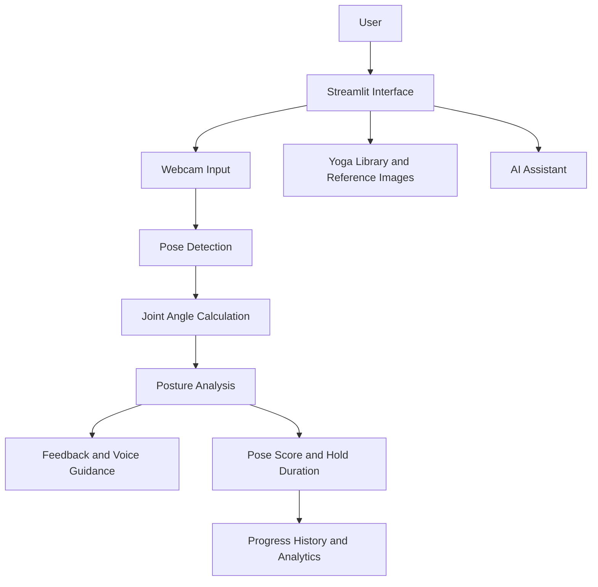

# 🧘 YogaCare AI — AI-Powered Yoga Posture Detection & Guidance System

YogaCare AI is an AI-powered yoga and wellness application that combines computer vision and artificial intelligence to make yoga practice more interactive and accessible. It helps users analyze yoga postures, receive alignment feedback, follow guided instructions, and track their practice progress.

## ✨ Features

- 📹 **Real-Time Pose Detection** — Detect body landmarks using a webcam.
- 🧍 **Yoga Posture Analysis** — Analyze supported yoga poses and provide posture feedback.
- 🖼️ **Reference Pose Guidance** — View real human yoga reference images.
- 🤖 **AI-Powered Assistance** — Generate helpful explanations and guidance using an AI API, when configured.
- 🔊 **Voice Guidance** — Listen to yoga instructions and feedback.
- 📊 **Progress Tracking** — Track practice sessions, pose scores, and hold duration.
- 📈 **Workout Analytics** — Review practice history and progress charts.
- 🌿 **Yoga Practice Library** — Explore yoga poses and guided practice options.
- 🎯 **Beginner-Friendly Interface** — Follow instructions and receive understandable feedback.

## 🛠️ Technologies Used

| Technology | Purpose |
|---|---|
| Python | Core application development |
| Streamlit | Interactive web interface |
| OpenCV | Webcam and video processing |
| MediaPipe / Pose Estimation | Body landmark detection |
| Groq API | AI-powered assistance, if configured |
| Text-to-Speech | Audio instructions and feedback |
| JSON | Local data and practice history storage |

*The technologies and features listed should match the components implemented in your actual project.*

## 🏗️ System Architecture



## 📋 Requirements

Before installing YogaCare AI, make sure you have:

- **Python:** A compatible Python version for your installed dependencies.
- **pip:** Python package installer.
- **Webcam:** Required for live yoga posture detection.
- **Internet connection:** Required for installing packages and using cloud-based AI services.
- **Groq API key:** Required only if your application uses the Groq API.

## 📦 Dependency Installation

### Step 1: Open the project folder

Open the YogaCare AI project folder in Visual Studio Code.

### Step 2: Create a virtual environment

Open the VS Code terminal and run:

```bash
python -m venv .venv
```

### Step 3: Activate the virtual environment

For Windows PowerShell:

```powershell
.\.venv\Scripts\Activate.ps1
```

If PowerShell blocks activation, you can use Command Prompt instead:

```cmd
.venv\Scripts\activate.bat
```

### Step 4: Upgrade pip

```bash
python -m pip install --upgrade pip
```

### Step 5: Install project dependencies

If your repository contains a `requirements.txt` file, run:

```bash
pip install -r requirements.txt
```

This installs the Python packages listed in the dependency file.

**Important:** Keep `requirements.txt` updated with the packages your application actually uses. Avoid installing unrelated packages unnecessarily.

## 🔑 API Configuration

If your project uses the Groq API:

1. Create a `.env` file in the project root if your application supports environment variables through this file.
2. Add the API key using the exact variable name expected by your code.
3. Keep your API key private.

Example configuration:

```env
GROQ_API_KEY=your_groq_api_key_here
```

Replace the placeholder with your own key. Never commit real API keys, passwords, or tokens to GitHub. Add `.env` to `.gitignore`.

If your project does not use the Groq API, this step is not required.

## ▶️ How to Run

After installing dependencies, run the Streamlit application from the project root:

```bash
python -m streamlit run app.py
```

Open the local URL displayed in the terminal, usually:

`http://localhost:8501`

Keep the terminal open while using the application.

## 📁 Project Structure

The following is an example structure. Adjust the filenames and folders to match your actual repository.

```text
YogaCare-AI/
├── app.py
├── requirements.txt
├── .env.example
├── .gitignore
├── assets/
│   └── reference_poses/
├── data/
│   └── workout_history.json
├── modules/
│   ├── pose_detection.py
│   ├── posture_analysis.py
│   └── voice_assistant.py
└── README.md
```

## 📊 Expected Workflow

1. Open YogaCare AI in your browser.
2. Select a yoga practice or supported posture.
3. Allow webcam access if live pose detection is required.
4. Follow the reference instructions and practise the pose.
5. Review available posture feedback and session information.
6. Check your saved practice history and progress analytics, if enabled.

## 🔮 Future Enhancements

- Support for additional yoga poses.
- Multilingual guidance, including Kannada.
- More personalized practice routines.
- Improved reference-based posture comparison.
- Enhanced progress reports and analytics.
- Additional accessibility features.

## ⚠️ Disclaimer

YogaCare AI is an educational wellness project. Computer vision-based posture feedback is an estimate and may not always be accurate. The application does not diagnose or treat medical conditions and does not replace professional medical advice or qualified yoga instruction. Stop practising if you experience pain or discomfort.

## 👨‍💻 Author

**Shrinivas Naik**  
Computer Science and Engineering Student

GitHub: [shrinivasnaik25](https://github.com/shrinivasnaik25)

---

*Built with Python, computer vision, and AI to make yoga practice more interactive and accessible.*
